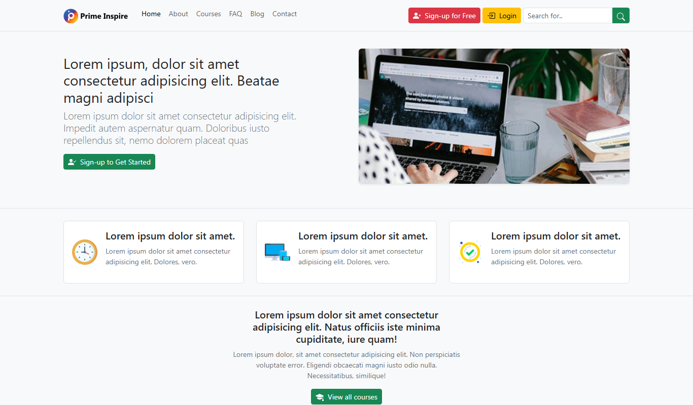
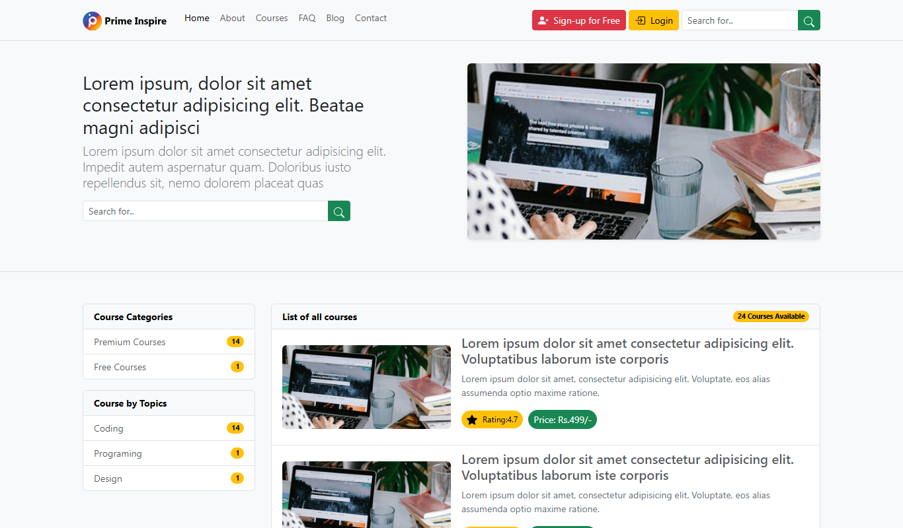
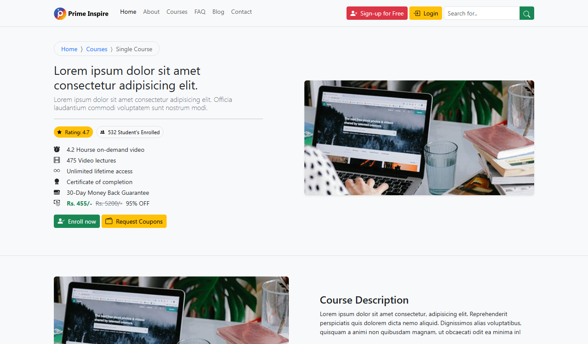
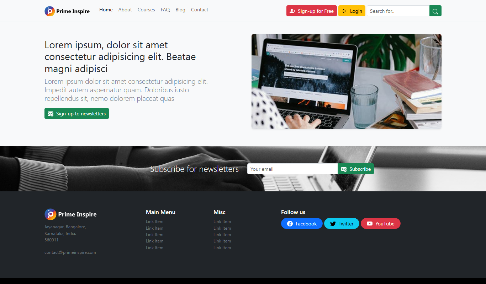
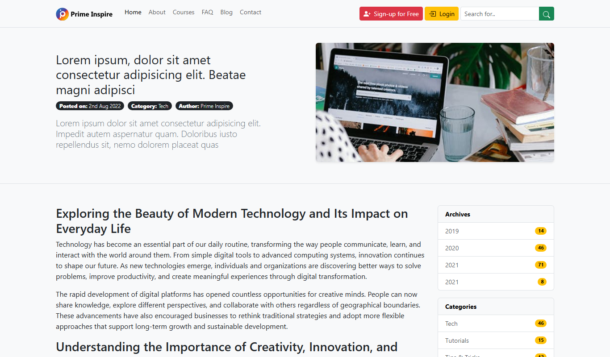
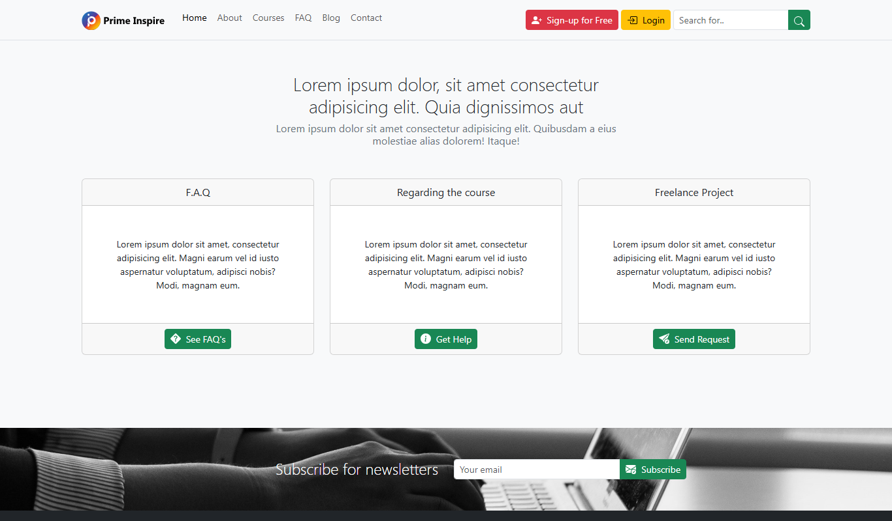

# 🎓 RW Education (Real World Education)

[](https://opensource.org/licenses/MIT)
[](https://getbootstrap.com/)
[](https://developer.mozilla.org/en-US/docs/Web/HTML)
[](https://developer.mozilla.org/en-US/docs/Web/CSS)
[](#)

A modern, responsive, and lightweight **E-Learning & Educational Platform Template** built with **HTML5**, **CSS3**, and **Bootstrap 5**. Designed for online academies, universities, tutorial centers, and independent instructors to showcase courses, publish articles, and connect with students seamlessly.

---

## 📌 Table of Contents

- [✨ Key Features](#-key-features)
- [🖥️ UI Previews & Screenshots](#️-ui-previews--screenshots)
- [📂 Project Structure](#-project-structure)
- [📄 Pages Overview](#-pages-overview)
- [🛠️ Tech Stack & Tools](#️-tech-stack--tools)
- [🚀 Getting Started](#-getting-started)
- [🎨 Customization](#-customization)
- [🤝 Contributing](#-contributing)
- [📄 License](#-license)
- [👤 Author](#-author)

---

## ✨ Key Features

- **📱 Fully Responsive Design:** Tailored for all screen sizes (Desktops, Laptops, Tablets, and Mobile phones).
- **🪟 Modern UI with Glassmorphism:** Sticky navigation bar with backdrop blur (`backdrop-filter: blur(8px)`) effect.
- **📚 Course Catalog & Filters:** Organized course browsing by category, topic tags, price badges (Free / Premium), and ratings.
- **🎓 Dedicated Course Details:** In-depth single-course page featuring course overview, syllabus breakdown, instructor profile, and review metrics.
- **📰 Educational Blog & Articles:** Clean blog directory and reader-friendly single post layout.
- **❓ Interactive FAQ Page:** Accordion-based FAQ section for quick answers to common queries.
- **📬 Contact & Modal Forms:** Integrated contact options with interactive Bootstrap modals for messages and queries.
- **⚡ Fast & Lightweight:** Zero heavy JavaScript frameworks; uses Bootstrap 5 CDN and native SVGs for maximum loading speed.
- **📲 Mobile Bottom Navigation:** Sticky quick-action bar for mobile devices for high conversion and seamless navigation.

---

## 🖥️ UI Previews & Screenshots

### 1. Home Page
*The landing page featuring hero banner, value propositions, featured courses, and partner brands.*



---

### 2. Courses Directory
*Course catalog with categorical filtering, topic badges, and availability tags.*



---

### 3. Single Course Details
*Comprehensive view of a specific course with curriculum details, enrollment options, and reviews.*



---

### 4. Blog Listing
*Articles, tutorials, and academic news organized with search and sidebar navigation.*



---

### 5. Single Blog Post
*Clean and readable long-form post layout with author credentials and comment sections.*



---

### 6. Contact & Support
*Contact channels, direct request cards, FAQ shortcuts, and modal-based messaging forms.*



---

## 📂 Project Structure

```text
RW-Education/
│
├── ReadmeImages/              # Screenshots and visual assets for documentation
│   ├── blog.png
│   ├── contact.png
│   ├── courses.png
│   ├── home.png
│   ├── single-course.png
│   └── single-post.png
│
├── img/                       # Project images, graphics, and logos
│   ├── clock.png
│   ├── main-header.jpg
│   ├── Prime-Inspire-Logo.svg
│   ├── Prime-Inspire-Logo-dark.svg
│   ├── responsive.png
│   ├── subscribe.jpg
│   └── tick.png
│
├── about.html                 # About us / Institute story & mission
├── blog.html                  # Blog index page
├── contact.html               # Contact page with support modal
├── courses.html               # Course catalog & categories
├── faq.html                   # Frequently asked questions
├── index.html                 # Main landing page
├── single-course.html         # Individual course view
├── single-post.html           # Individual blog article view
├── styles.css                 # Custom CSS rules and enhancements
└── README.md                  # Project documentation
```

---

## 📄 Pages Overview

| File | Page Name | Description |
| :--- | :--- | :--- |
| [`index.html`](index.html) | **Home** | Hero section, key features, course showcase, newsletter subscription, and footer. |
| [`about.html`](about.html) | **About Us** | Information about the organization, mission, team, and educational values. |
| [`courses.html`](courses.html) | **Courses** | Complete course catalog categorized by topics (Coding, Design, etc.) and tags. |
| [`single-course.html`](single-course.html) | **Course Details** | Detailed curriculum, prerequisites, instructors, ratings, and enrollment CTAs. |
| [`blog.html`](blog.html) | **Blog** | Article listings, recent publications, category filters, and search bar. |
| [`single-post.html`](single-post.html) | **Article Reader** | Full blog post content, author profile, and related discussion. |
| [`faq.html`](faq.html) | **FAQ** | Accordion-driven answers to frequent student and course inquiries. |
| [`contact.html`](contact.html) | **Contact** | Support cards, modal inquiry form, freelance request links, and office address. |

---

## 🛠️ Tech Stack & Tools

- **Markup:** [HTML5](https://developer.mozilla.org/en-US/docs/Web/HTML) (Semantic Elements)
- **Styling:** [CSS3](https://developer.mozilla.org/en-US/docs/Web/CSS) (Custom styles, responsive rules, backdrop filter)
- **Framework:** [Bootstrap v5.3.8](https://getbootstrap.com/)
- **Icons:** [Bootstrap Icons (SVG)](https://icons.getbootstrap.com/)
- **Scripts:** [Popper.js v2.11.8](https://popper.js.org/) & Bootstrap Bundle JS

---

## 🚀 Getting Started

No complicated build tools or dependencies are required. You can run this project directly in any modern web browser.

### 1. Clone the Repository

```bash
git clone https://github.com/sajidsam/RW-Education.git
```

### 2. Navigate to the Project Directory

```bash
cd RW-Education
```

### 3. Open in Browser

- Simply double click [`index.html`](index.html) to view it in your browser.
- **OR** use VS Code extension **Live Server** (Right click `index.html` -> *Open with Live Server*).
- **OR** run a lightweight local HTTP server:

```bash
# Using Python
python -m http.server 3000

# Using Node.js npx
npx serve .
```

Then visit `http://localhost:3000` in your browser.

---

## 🎨 Customization

1. **Logo & Branding:**
   - Replace `img/Prime-Inspire-Logo.svg` and `img/Prime-Inspire-Logo-dark.svg` with your own logo.
2. **Color Palette & Accents:**
   - Modify Bootstrap utility classes (e.g. `btn-success`, `text-bg-warning`) or customize colors in `styles.css`.
3. **Contact Details & Social Links:**
   - Update address, email, and social media handles in the footer section of each HTML page.

---

## 🤝 Contributing

Contributions are always welcome!

1. Fork the Project (`https://github.com/sajidsam/RW-Education/fork`)
2. Create your Feature Branch (`git checkout -b feature/NewFeature`)
3. Commit your Changes (`git commit -m 'Add some NewFeature'`)
4. Push to the Branch (`git push origin feature/NewFeature`)
5. Open a Pull Request

---

## 📄 License

This project is licensed under the **MIT License**. Feel free to use, modify, and distribute it for personal or commercial projects.

---

## 👤 Author

**Sajidul Islam**
- GitHub: [@sajidsam](https://github.com/sajidsam)
- Email: [isajidul174@gmail.com](mailto:isajidul174@gmail.com)

⭐ If you found this template useful, please consider giving this repository a star!

